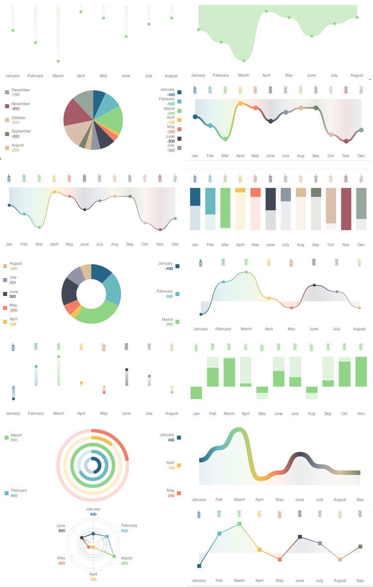
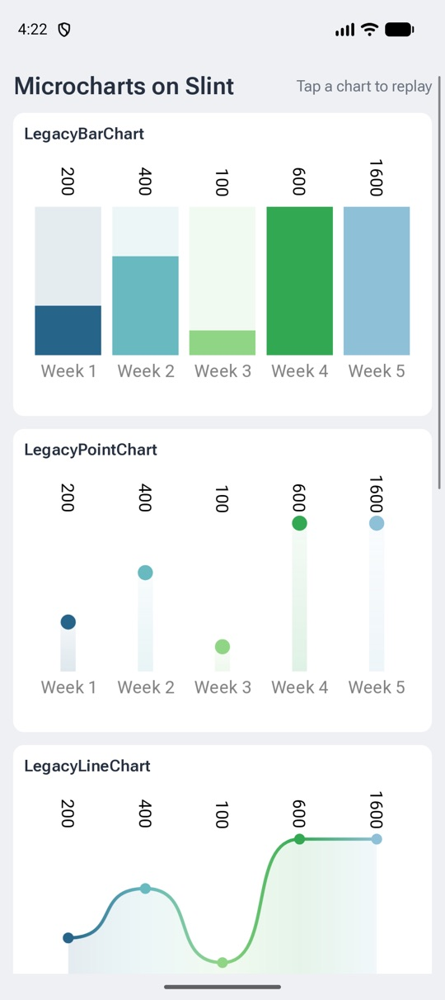
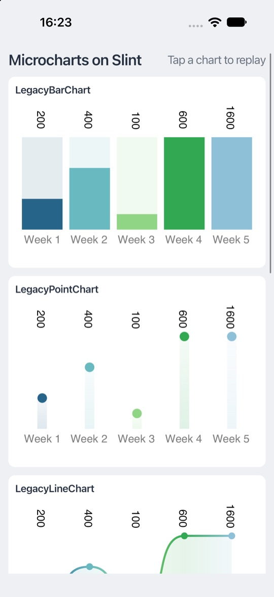

# Microcharts

[](https://github.com/microcharts-dotnet/Microcharts/actions/workflows/pull-request.yml)
[](https://www.nuget.org/packages/Microcharts/)


**Microcharts** is an extremely simple charting library for a wide range of platforms (see *Compatibility* section below), with shared code and rendering for all of them!

Read our [wiki](https://github.com/microcharts-dotnet/Microcharts/wiki) to learn more about how to use this library.

## About

This project is just simple drawing on top of the awesome [SkiaSharp](https://github.com/mono/SkiaSharp) library. The purpose is not to have an heavily customizable charting library. If you want so, simply fork the code, since all of this is fairly simple.

## Contributions

Contributions are welcome! If you find a bug please report it and if you want a feature please report it.

If you want to contribute code please file an issue and create a branch off of the `main` branch and file a pull request.

More info on how you can help can be found [here](https://github.com/microcharts-dotnet/Microcharts/wiki/Contributing).

## Gallery




## Install

Available on NuGet:

* [Microcharts](https://www.nuget.org/packages/Microcharts/) — meta-package (start here)
* [Microcharts.Core](https://www.nuget.org/packages/Microcharts.Core/) — cross-platform rendering
* [Microcharts.Maui](https://www.nuget.org/packages/Microcharts.Maui/) — MAUI `ChartView`

The native iOS and Android views — `Microcharts.iOS` and `Microcharts.Droid` — are published to the [GitHub Packages feed](https://github.com/orgs/microcharts-dotnet/packages) rather than nuget.org. Installing them requires adding the org feed as a NuGet source and authenticating with a GitHub token that has `read:packages`.

**.NET MAUI**

Don't forget to call `UseMicrocharts()` on `MauiAppBuilder` in the `MauiProgram` class.

**Slint**

[Slint](https://slint.dev) apps show a chart in a `ChartView` from `Sources/Microcharts.Slint/chart-view.slint`,
an `Image` that reports its size, and draw it with a `ChartRenderer` from `Microcharts.Slint`:

```slint
import { ChartView } from "chart-view.slint";

export component AppWindow inherits Window {
    in property <image> sales-chart;
    callback sales-chart-resized(length, length);

    ChartView {
        source: root.sales-chart;
        resized(width, height) => { root.sales-chart-resized(width, height); }
    }
}
```

```csharp
SlintTimer.Install(); // before creating charts, so that they animate on the Slint thread
using var app = AppWindow.Create();
var renderer = new ChartRenderer(app.Window, image => app.SalesChart = image)
{
    Chart = new BarChart { Entries = entries },
};
app.OnSalesChartResized(renderer.Resize);
app.Run();
```

The chart's sizes, such as `LabelTextSize`, are in logical pixels, like Slint's lengths,
and the renderer draws at the window's scale factor.
`Sources/Microcharts.Samples.Slint` has a gallery for the desktop, Android, and iOS.

## Tutorials

* [Video: Charts for Xamarin.Forms](https://www.youtube.com/watch?v=tmymWdmf1y4) by [@HoussemDellai](https://github.com/HoussemDellai) *(legacy Xamarin.Forms; the charting concepts still apply)*

## Compatibility

Built-in views are provided for the following, all targeting .NET 10 and rendered with SkiaSharp:

* .NET MAUI (Windows, Android, iOS, and Mac Catalyst)
* .NET for iOS — native `Microcharts.iOS` view
* .NET for Android — native `Microcharts.Droid` view
* [Slint](https://slint.dev) (macOS, Linux, Windows, Android, and iOS) — `Microcharts.Slint`, a `ChartRenderer` for a Slint `Image`

| Android | iOS |
| --- | --- |
|  |  |

## License

MIT © [Aloïs Deniel](https://aloisdeniel.com), [Ed Lomonaco](https://edlomonaco.dev) & [Jonas Follesø](https://github.com/follesoe)
