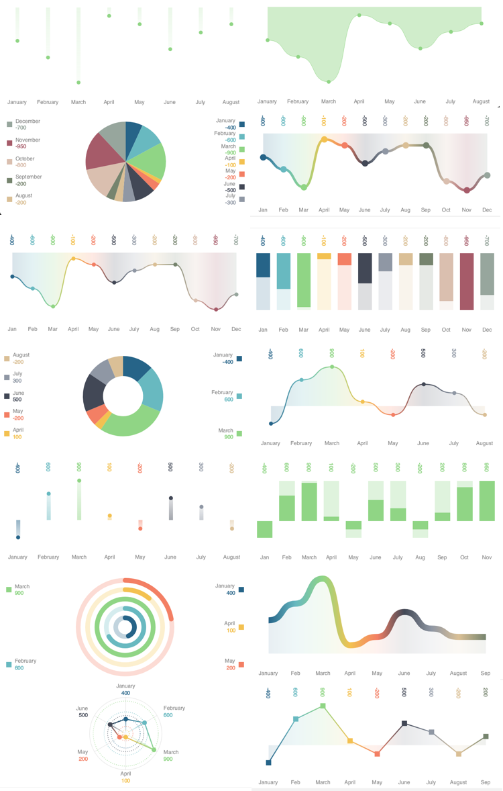

# Microcharts

[](https://github.com/microcharts-dotnet/Microcharts/actions/workflows/pull-request.yml)
[](https://www.nuget.org/packages/Microcharts/)


**Microcharts** is an extremely simple charting library for a wide range of platforms (see *Compatibility* section below), with shared code and rendering for all of them!

Read our [wiki](https://github.com/microcharts-dotnet/Microcharts/wiki) to learn more about how to use this library.

## About

This project is just simple drawing on top of the awesome [SkiaSharp](https://github.com/mono/SkiaSharp) library. The purpose is not to have an heavily customizable charting library. If you want so, simply fork the code, since all of this is fairly simple.

## Contributions

Contributions are welcome! If you find a bug please report it and if you want a feature please report it.

If you want to contribute code please file an issue and create a branch off of the `main` branch and file a pull request.

More info on how you can help can be found [here](https://github.com/microcharts-dotnet/Microcharts/wiki/Contributing).

## Gallery




## Install

Available on NuGet:

* [Microcharts](https://www.nuget.org/packages/Microcharts/) — meta-package (start here)
* [Microcharts.Core](https://www.nuget.org/packages/Microcharts.Core/) — cross-platform rendering
* [Microcharts.Maui](https://www.nuget.org/packages/Microcharts.Maui/) — MAUI `ChartView`

The native iOS and Android views — `Microcharts.iOS` and `Microcharts.Droid` — are published to the [GitHub Packages feed](https://github.com/orgs/microcharts-dotnet/packages) rather than nuget.org. Installing them requires adding the org feed as a NuGet source and authenticating with a GitHub token that has `read:packages`.

**.NET MAUI**

Don't forget to call `UseMicrocharts()` on `MauiAppBuilder` in the `MauiProgram` class.

## Tutorials

* [Video: Charts for Xamarin.Forms](https://www.youtube.com/watch?v=tmymWdmf1y4) by [@HoussemDellai](https://github.com/HoussemDellai) *(legacy Xamarin.Forms; the charting concepts still apply)*

## Compatibility

Microcharts 3.1 targets **.NET 10 and .NET 11**, with separate assets for both
framework versions in each NuGet package.

Built-in views are provided for the following, all rendered with SkiaSharp:

* .NET MAUI (Windows, Android, iOS, and Mac Catalyst)
* .NET for iOS — native `Microcharts.iOS` view
* .NET for Android — native `Microcharts.Droid` view

MAUI dependencies are selected per target framework. MAUI apps must reference
`Microsoft.Maui.Controls` at the version below or a newer compatible version:

| Target framework | Minimum MAUI version |
| --- | --- |
| .NET 10 | 10.0.130 |
| .NET 11 | 11.0.10 |

## Building

Install the .NET 11 SDK specified in `global.json`, then run:

```sh
dotnet workload install android ios maccatalyst maui
dotnet build Sources/Microcharts.Maui/Microcharts.Maui.csproj --configuration Release
```

Library builds compile both .NET 10 and .NET 11 targets. On Windows, build the full
solution with `dotnet build Sources/Microcharts.slnx --configuration Release`.

On macOS, Apple sample apps require Xcode 26.0 for .NET 10 or Xcode 27.2 for .NET 11.
Select the matching Xcode, then run `bash buildpackages-maui.sh net10.0` or
`bash buildpackages-maui.sh net11.0`. Each command packs both framework versions
and builds samples for the selected framework. Windows targets are built on Windows.

## License

MIT © [Aloïs Deniel](https://aloisdeniel.com), [Ed Lomonaco](https://edlomonaco.dev) & [Jonas Follesø](https://github.com/follesoe)
